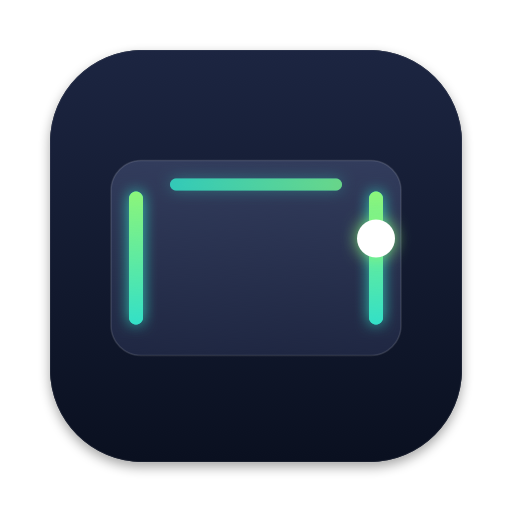
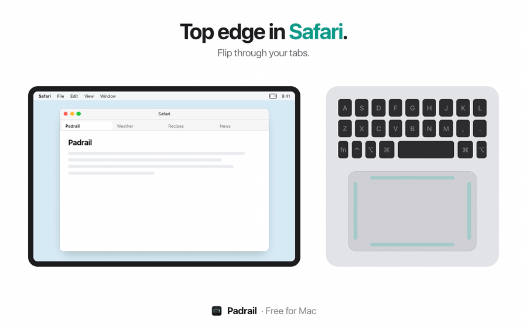
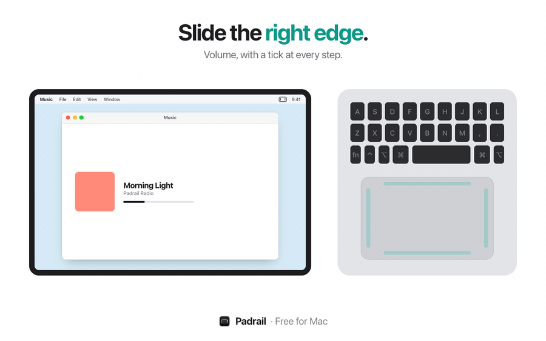
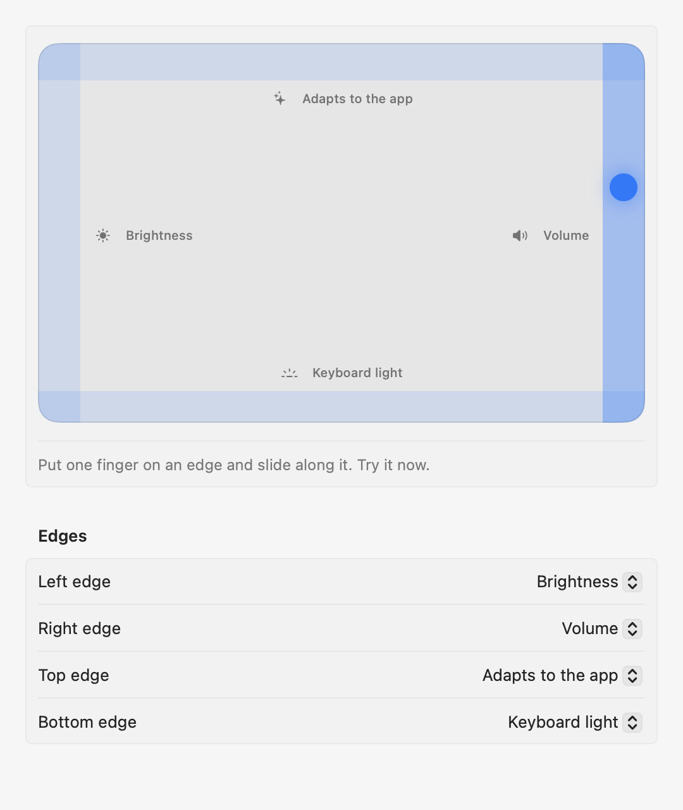

  

<h1 align="center">Padrail</h1>

  <b>Your MacBook trackpad's edges, as controls.</b> 
  Free for Mac · macOS 13 or later · Apple Silicon and Intel

  <a href="https://github.com/iancona/padrail/releases/latest/download/Padrail.dmg"><b>Download Padrail</b></a>
  &nbsp;·&nbsp;
  <a href="https://padrail.xyz">padrail.xyz</a>

  

## What it does

Put one finger right on an edge of the trackpad and slide along it.

| Edge | What it controls |
|---|---|
| **Right** | Volume, with a tick at every step |
| **Left** | Display brightness |
| **Top** | Adapts to the app in front: tabs in your browser, zoom in Figma and Preview, tracks in Spotify and Music, desktops everywhere else |
| **Bottom** | Keyboard light |

Every edge can be given a different job (volume, brightness, keyboard light, tabs, zoom, seek, tracks, undo and redo, desktops) or turned off. The adaptive edge has a per-app list you can edit.

  

## Install

1. [Download Padrail.dmg](https://github.com/iancona/padrail/releases/latest/download/Padrail.dmg) and open it.
2. Drag Padrail into Applications and open it. It shows the settings window so you can try every edge right away.
3. For tabs, zoom, tracks and desktops, allow Padrail in **System Settings → Privacy & Security → Accessibility**. Volume, brightness and keyboard light need no permission.

Padrail is signed and notarized by Apple, and it updates itself when a new version is out.

  

## Good to know

- **No accidental triggers.** A slide only counts when a single finger lands on the edge and moves along it. Clicks, scrolling and gestures work as before.
- **Private.** No account and no analytics. The only connection Padrail makes is a daily check for updates.
- **Light.** It lives in the menu bar, has no Dock icon and uses no CPU while you're not touching an edge.
- **Keyboard light** follows macOS: in a bright room, with automatic keyboard brightness on, macOS keeps the backlight off.

## Uninstall

Quit Padrail from its menu bar icon and drag it from Applications to the Trash.

---

© 2026 Padrail · Free for everyone

